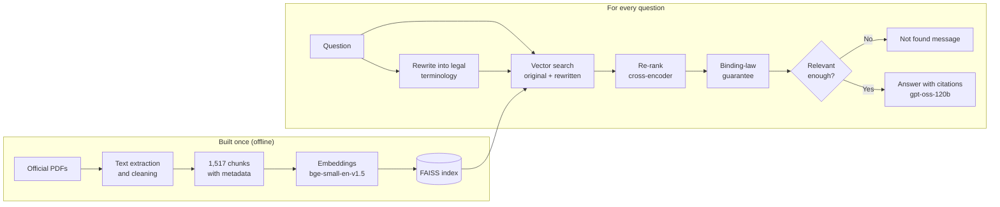

# EU AI Act Assistant for SMEs

An AI assistant that helps small and medium-sized businesses understand the EU AI Act. It answers questions in plain English, using only official EU sources, and cites the document and page behind every statement.

**Live demo:** https://eu-ai-act-sme-assistant.streamlit.app/

> The demo runs on Streamlit Community Cloud's free tier. If it has had no visitors for 12 hours it goes to sleep: click the button to wake it, and allow a minute or two for it to start.

> **Not legal advice.** This is an unofficial portfolio project. It can make mistakes, and its answers should always be checked against the cited sources.

---

## Why this project

The EU AI Act affects every business that builds or uses AI, but the law is long, technical and still changing. In July 2026, the Digital Omnibus on AI (Regulation (EU) 2026/1744) moved several key deadlines, so many summaries written before then are now out of date. An SME owner who asks a general-purpose chatbot "when do the high-risk rules apply?" can easily get the old answer.

This assistant is built to avoid that: it answers only from a versioned set of official documents, including the amending regulation, and shows exactly where each answer comes from.

## Knowledge base

| # | Document | Publisher | Type | Version used |
|---|---|---|---|---|
| 01 | Regulation (EU) 2024/1689 (Artificial Intelligence Act) | EUR-Lex | Binding law | Consolidated version of 27 July 2026, including the 2026/1744 amendments |
| 02 | Regulation (EU) 2026/1744 (Digital Omnibus on AI) | EUR-Lex | Binding law (amending) | As published, in force 27 July 2026 |
| 03 | Guidelines on the definition of an AI system | European Commission | Non-binding guidance | As published |
| 04 | Guidelines on prohibited AI practices | European Commission | Non-binding guidance | As published |
| 05 | Guidelines on the transparency obligations under Article 50 | European Commission | Non-binding guidance | Final version of 20 July 2026, C(2026) 5054 final (not the May 2026 draft) |

Every document's source link, licence, version and download date is recorded in [`data/sources.csv`](data/sources.csv). All documents are reused under the European Commission's reuse policy (Commission Decision 2011/833/EU), with the source acknowledged.

The assistant labels each source as **binding law** or **non-binding guidance**, so users can tell a legal obligation from the Commission's interpretation of it.

## How it works



1. **Extraction and cleaning.** Text is extracted with pdfplumber, then cleaned of page headers, footers, Official Journal markers and amendment markers using patterns written from observed examples. Automated checks confirm that no known noise remains in any chunk.
2. **Chunking.** Pages are split into chunks of about 1,000 characters (roughly 250 tokens) with a 150-character overlap. Chunks never cross a page boundary, so every citation points to the correct page.
3. **Embedding and indexing.** Each chunk is embedded with `BAAI/bge-small-en-v1.5` and stored in a FAISS index.
4. **Query rewriting.** A small model (`gpt-oss-20b`) rewrites the user's everyday question into the law's terminology, for example "Do I have to tell users they're talking to a chatbot?" becomes "obligation to inform users that they are interacting with an AI system".
5. **Search and re-ranking.** Both the original and the rewritten question are searched. The merged candidates are re-scored by a cross-encoder (`ms-marco-MiniLM-L-6-v2`), which reads the question and each passage together.
6. **Binding-law guarantee.** If none of the top 4 passages is binding law, the best binding-law passage is swapped in, so answers about obligations can rest on the law itself.
7. **Relevance gate.** If even the best passage scores below a threshold, the assistant says it could not find the answer, without calling the language model at all.
8. **Answering.** `gpt-oss-120b` writes the answer from the 4 passages, following strict rules: use only the sources, cite every statement, distinguish law from guidance, prefer the most recent law for dates, and admit when the sources do not contain the answer.

## Key design decisions

Most decisions were made by measuring alternatives rather than assuming.

- **pdfplumber instead of pypdf.** The EU's justified-text PDFs caused pypdf to split words ("tes ting", "m arket"). A side-by-side comparison on sample pages from two publishers ([`scripts/compare_pdf_text.py`](scripts/compare_pdf_text.py)) showed pdfplumber produced clean text.
- **Table extraction only where tables are real.** Automatic table detection fixed the summary table in the Article 50 guidelines, but inspecting every detection ([`scripts/inspect_tables.py`](scripts/inspect_tables.py)) showed that in another document most "tables" were footnote separators and margin boxes, which it broke apart. Table extraction is therefore enabled only for the document where it was verified.
- **Re-ranking and query rewriting, chosen by diagnosis.** A diagnostic script ([`scripts/diagnose_retrieval.py`](scripts/diagnose_retrieval.py)) measured where the correct passage ranked for difficult questions. Re-ranking fixed ranking problems (the updated Annex III deadline moved from rank 3 to rank 1). It could not fix the vocabulary gap between everyday questions and legal wording ("chatbot" versus "AI systems intended to interact directly with natural persons"), which query rewriting did.
- **Few-shot examples kept separate from test questions.** The rewriter's worked examples deliberately exclude every evaluation question, to avoid data leakage.
- **A separate model for rewriting.** The provider's rate limits are per model, so the smaller rewriting model does not consume the answering model's allowance.
- **FAISS used directly, without pickle.** The index is stored in FAISS's own format and the chunk text as plain JSON, avoiding Python pickle files, which can execute code when loaded.
- **A provider-agnostic design.** The first LLM provider blocked the project unless billing was added. Because the provider sits behind LangChain, switching to Groq changed only a few lines.
- **Safety for a public app.** A relevance gate, a rule against following instructions found inside questions or sources, a scope rule for neighbouring laws such as the GDPR, a limit of 10 questions per session and 500 characters per question, a disclaimer, and a privacy notice telling users not to enter personal data. The LLM runs on a free tier with no billing attached, so the public demo cannot generate costs.

## Evaluation

The system was evaluated on **10 new questions** that were not used during development, covering definitions, prohibitions, obligations, dates, penalties, scope, an unanswerable question and an off-topic question. The system was not changed after the evaluation. Full answers are in [`eval/results.md`](eval/results.md) and the grading in [`eval/grading.md`](eval/grading.md).

| Measure | Result |
|---|---|
| Fully correct | 7 of 10 |
| Partially correct | 3 of 10 |
| Wrong | 0 of 10 |
| Unanswerable and off-topic questions handled correctly (no invented answers) | 2 of 2 |
| Binding law cited on legal questions | 6 of 8 |
| Response time (on a laptop) | 2.6 to 4.8 seconds |

Four citations were spot-checked against the source PDFs: three were confirmed, and one revealed the binding-law guarantee weakness described below.

**Caveats:** 10 questions is a small sample, and grading was done by the author with partial verification against the sources, not by legal experts.

## Known limitations

These come from the evaluation and from testing during development.

- **Incomplete answers for provisions with many parts.** Only 4 passages reach the model, so answers about long lists, such as all deployer obligations under Article 26, can be incomplete. Broad questions like "what are the main things to keep in mind?" get narrow answers for the same reason.
- **Framing errors.** An answer can be factually close but framed misleadingly, for example opening with "Yes" for a practice that is prohibited with narrow exceptions.
- **Occasional uncited claims.** Despite strict rules, the model sometimes adds context from its general knowledge, especially for advice-seeking questions ("how can SMEs...").
- **Neighbouring laws.** Questions about the GDPR or personal data may still produce answers that go beyond the sources, although a scope rule reduces this.
- **The binding-law guarantee can insert an irrelevant passage.** It guarantees *a* binding passage, not a relevant one. Planned fix: only insert a binding passage whose re-ranker score is above the relevance threshold.
- **Article 5 is hard to retrieve for single prohibitions.** Article 5 lists all prohibitions together, so the chunk for a specific one (such as emotion recognition at work) scores below more focused guidance passages.
- **Text extraction trade-offs.** Footnote numbers can remain attached to words, and tables are moved to the end of their page's text.
- **Free-tier capacity.** The answering model's free tier allows roughly 80 to 100 questions per day across all visitors. When the limit is reached, the app shows a "busy" message rather than failing.
- **A snapshot in time.** The knowledge base reflects documents downloaded in October 2026. Later changes to the law or guidance are not included.

## Run it locally

Requires Python 3.12 and a free [Groq](https://console.groq.com) API key.

```bash
git clone https://github.com/hamzakhan-ds/eu-ai-act-sme-assistant.git
cd eu-ai-act-sme-assistant
python -m venv .venv
# Windows: .venv\Scripts\activate    macOS/Linux: source .venv/bin/activate
pip install -r requirements.txt
```

Copy `.env.example` to `.env` and add your Groq API key. Then start the app:

```bash
streamlit run app.py
```

The FAISS index is included in the repository. To rebuild it after changing the documents or chunking settings:

```bash
python -m src.build_index
```

## Run with Docker

With your `.env` file in place (see above):

```bash
docker build -t eu-ai-act-assistant .
docker run -p 8501:8501 --env-file .env eu-ai-act-assistant
```

Then open http://localhost:8501. The API key is passed in when the container starts and is never copied into the image (`.env` is excluded by `.dockerignore`). The image installs the CPU-only build of PyTorch and downloads both models at build time, so the container starts without further downloads.

## Project structure

```
app.py                    Streamlit chat interface
Dockerfile                Container build (CPU-only PyTorch, models baked in)
.dockerignore             Keeps secrets, the virtual environment and raw PDFs out of the image
requirements.txt          Pinned dependencies
data/
  raw/                    Source PDFs
  sources.csv             Source register: links, licences, versions, dates
  index/                  FAISS index, chunk text and build settings
src/
  ingest.py               Extraction, cleaning, noise checks and chunking
  build_index.py          Embedding and index building
  rewrite.py              Query rewriting with few-shot examples
  retrieve.py             Dual-query search, re-ranking, binding-law guarantee
  answer.py               Prompt, relevance gate, citations and error handling
scripts/                  Diagnostics, comparisons, evaluation and utilities
eval/
  questions.csv           Evaluation questions
  results.md              Answers and sources from the evaluation run
  grading.md              Grading, spot-checks and weaknesses found
```

## Tech stack

Python · LangChain · pdfplumber · sentence-transformers · FAISS · Groq (gpt-oss-120b, gpt-oss-20b) · Streamlit · Docker · Streamlit Community Cloud

## Licence and attribution

Code: MIT licence. Source documents: © European Union, reused under Commission Decision 2011/833/EU. This project is not affiliated with or endorsed by the European Union.

## Author

Hamza Khan · linkedin.com/in/hamza-khan-5625751ba/ · github.com/hamzakhan-ds/